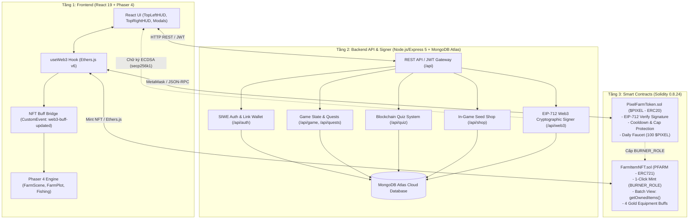

# 🌾 Pixel2D GameFi - Nông Trại 2D Blockchain (Web 2.5 Hybrid)

Dự án đồ án Blockchain chuyên đề **GameFi Nông Trại 2D** xây dựng trên nền tảng **React 19**, **Phaser 4**, **Node.js/Express 5**, **MongoDB Atlas (Mongoose)** và **Solidity 0.8.24 (Hardhat / OpenZeppelin v5)**.

Dự án kết hợp trải nghiệm gameplay 2D sống động (trồng trọt, thu hoạch, câu cá hồ nước, làm nhiệm vụ, quản lý thể lực) với các cơ chế kinh tế Web3 an toàn, tối ưu trải nghiệm người dùng (**1-Click Mint NFT**, **Chữ Ký ECDSA/EIP-712 Backend Signer**, **NFT Buff Bridge**, **Cơ Chế Hybrid Web 2.5 Liên Kết Ví An Toàn** và **Lớp Học Blockchain Nhận Thưởng**).

---

## 🏛️ Kiến Trúc Hệ Thống (3 Tầng Hoàn Chỉnh)



---

## 🌟 7 Điểm Sáng Tạo & Đột Phá Kỹ Thuật

1. **Cơ chế 1-Click Mint NFT (`BURNER_ROLE` / Vault Deposit)**:
   - Khác với quy trình ERC-20 truyền thống bắt buộc người chơi phải ký 2 giao dịch (`approve` rồi mới `mint`), Smart Contract `PixelFarmToken` cấp quyền `BURNER_ROLE` cho `FarmItemNFT` và tích hợp Treasury Vault. Người chơi chỉ cần ký **1 giao dịch duy nhất trên MetaMask**, token tự động được thanh toán và NFT đúc ngay lập tức vào ví, tiết kiệm 50% phí gas.
2. **Cơ chế Rút Token Bảo Mật Tuyệt Đối (EIP-712 Cryptographic Signer)**:
   - Ngăn chặn triệt để lỗ hổng gian lận người chơi tự gọi contract để mint token: Người chơi chỉ rút được `$PIXEL` khi có chữ ký EIP-712 do Backend Server ký (sau khi đã kiểm tra và trừ Coin trong Database).
   - Tích hợp chống Replay Attack (`usedNonces`), Hạn mức Cap (tối đa 10,000 Coin/phiên), Deadline hết hạn và Cooldown chống spam.
3. **Cầu Nối Hiệu Ứng NFT Buff Bridge (React -> Phaser)**:
   - Việc sở hữu NFT mang lại giá trị sử dụng thực tế (In-Game Utility):
     - **Lưỡi Liềm Vàng (NFT)**: Tăng +50% sản lượng nông sản khi gặt.
     - **Bình Tưới Vàng (NFT)**: Kích hoạt sự kiện `web3-buff-updated` giảm ngay **20% thời gian lớn của cây trồng** trong Phaser Engine.
     - **Cuốc Đất Vàng (NFT)**: Tăng tốc độ cuốc và chỉ tốn 1 Thể lực (thay vì 2).
     - **Cá Vàng May Mắn (NFT)**: Tăng gấp đôi cơ hội giật trúng các loài cá quý hiếm khi câu cá.
4. **Mô Hình Hybrid Web 2.5 & Liên Kết Ví An Toàn (Link-Wallet)**:
   - Hỗ trợ cả 2 phương thức: Đăng ký truyền thống (Username/Password) và Đăng nhập Web3 (SIWE MetaMask).
   - Cơ chế bảo toàn hồ sơ thông minh (`/api/auth/link-wallet`): Khi người dùng đang đăng nhập tài khoản truyền thống và kết nối MetaMask, hệ thống tự động liên kết ví vào chính tài khoản đó mà **không ghi đè hoặc chuyển nhầm sang tài khoản khác**.
5. **Lớp Học Trắc Nghiệm Blockchain & Bảng Nhiệm Vụ Hàng Ngày (Learn-to-Earn)**:
   - Hệ thống 10 câu hỏi trắc nghiệm kiến thức Web3/GameFi (Private Key, Gas fee, Smart Contract, Nonce, EIP-712, Consensus) thưởng Coin & XP trực tiếp.
   - Bảng 5 nhiệm vụ hàng ngày tương tác (Gieo hạt, Thu hoạch, Ghé bảng đổi thưởng, Nâng cấp kho, Thử thách nông dân chăm chỉ).
6. **Vòng Lặp Gameplay 2D Đầy Đủ & Hệ Thống Năng Lượng**:
   - Gieo hạt, tưới nước, xới đất, thu hoạch nông sản với spritesheet mượt mà.
   - Minigame câu cá tương tác thời gian thực với 4 điểm câu ven hồ nước.
   - Quản lý thể lực (Energy System): Tiêu hao thể lực theo từng hành động, hồi phục khi ăn nông sản hoặc nghỉ ngơi.
   - Âm thanh Retro 8-bit (Sound Engine) tự tạo qua Web Audio API không phụ thuộc tệp âm thanh ngoài.
7. **Cơ Sở Dữ Liệu MongoDB Atlas Cloud & Test Suites 100% Pass**:
   - Lưu trữ đám mây đồng bộ thời gian thực, có fallback tự động khi chạy test.
   - 18 Unit tests Smart Contracts (Hardhat): **18/18 Passed (100%)**.
   - 9 Integration tests Backend API & Signer: **9/9 Passed (100%)**.
   - TypeScript build frontend & backend: **0 Errors**.

---

## 🛠️ Hướng Dẫn Cài Đặt & Khởi Chạy

### 1. Cài đặt Dependencies cho cả 3 tầng

```bash
# Cài đặt Smart Contracts
cd contracts && npm install

# Cài đặt Backend
cd ../backend && npm install

# Cài đặt Frontend
cd ../front_end && npm install
cd ..
```

---

### 2. Khởi chạy dApp

#### ⚡ Cách 1: 1-Click Tự Động Khởi Chạy Bằng File Batch (Khuyên Dùng Trên Windows)
Nhấp đúp (Double-click) vào file **[`run_all.bat`](./run_all.bat)** tại thư mục gốc!  
File batch sẽ tự động thực hiện:
1. Mở cửa sổ Blockchain **Hardhat Local Node** (port 8545).
2. Tự động deploy Smart Contracts và xuất ABI sang Frontend.
3. Mở cửa sổ **Backend API & Web3 Signer** (port 4000).
4. Mở cửa sổ **Frontend dApp Game** (port 5173).
5. Tự động mở trình duyệt web tới: `http://localhost:5173`.

> 💡 *Khi muốn tắt toàn bộ các cửa sổ và tiến trình, chỉ cần chạy file **[`stop_all.bat`](./stop_all.bat)**.*

---

#### 🖥️ Cách 2: Khởi chạy thủ công bằng Terminal (Dành cho macOS / Linux)

##### Terminal 1: Khởi động Local Blockchain & Deploy Contracts
```bash
# Bước 1: Khởi động Hardhat node cục bộ (port 8545)
npm run contracts:node

# Bước 2 (Mở tab terminal mới): Triển khai hợp đồng lên node vừa chạy
npm run contracts:deploy
```
> *Lệnh deploy sẽ tự động trích xuất ABI và Contract Addresses sang `front_end/src/web3/abis/contracts.ts`.*

##### Terminal 2: Khởi động Backend API & Web3 Signer
```bash
npm run backend
```
> *Backend chạy tại `http://localhost:4000` (kết nối MongoDB Atlas Cloud).*

##### Terminal 3: Khởi động Game Frontend
```bash
npm run frontend
```
> *Frontend chạy tại `http://localhost:5173`.*

---

### 3. Cấu hình Ví MetaMask để Trải Nghiệm

#### Lựa chọn A: Mạng Ethereum Sepolia Testnet (Mạng Thực Tế Đã Deploy)
- **Network Name**: `Ethereum Sepolia Testnet`
- **RPC URL**: `https://rpc.sepolia.org` hoặc `https://ethereum-sepolia-rpc.publicnode.com`
- **Chain ID**: `11155111`
- **Currency Symbol**: `ETH`
- **Địa chỉ Contract $PIXEL**: `0x8350cac45079a5CA9781e8C8170bA82b54134B2A`

#### Lựa chọn B: Mạng Hardhat Localhost (Để Test Cục Bộ)
- **Network Name**: `Hardhat Localhost`
- **RPC URL**: `http://127.0.0.1:8545`
- **Chain ID**: `31337`
- **Currency Symbol**: `ETH`
- **Import Private Key tài khoản test (Hardhat Account #0)**:
  - `0xac0974bec39a17e36ba4a6b4d238ff944bacb478cbed5efcae784d7bf4f2ff80` (Có sẵn 10,000 ETH test).

---

## 🧪 Chạy Kiểm Thử Tự Động (Test Suites)

```bash
# 1. Chạy 18 Unit Tests cho Smart Contracts (Hardhat)
npm run test:contracts

# 2. Chạy 9 Integration Tests cho Backend API, Signer & Link Wallet
npm run test:backend
```

---

## 📁 Cấu Trúc Thư Mục Dự Án

```text
pixel2d/
├── contracts/                  # Tầng 3: Smart Contracts (Solidity 0.8.24)
│   ├── contracts/
│   │   ├── PixelFarmToken.sol  # Token ERC-20 ($PIXEL) + EIP-712 Claim + Faucet + BURNER_ROLE
│   │   └── FarmItemNFT.sol     # NFT ERC-721 + 1-Click Mint + getOwnedItems batch view
│   ├── test/
│   │   └── PixelFarm.test.ts   # Bộ 18 bài unit test kiểm thử hợp đồng (100% Pass)
│   ├── scripts/
│   │   └── deploy.ts           # Script deploy & xuất ABI sang front_end
│   └── hardhat.config.ts       # Cấu hình Hardhat (Localhost, Sepolia, Polygon Amoy)
│
├── backend/                    # Tầng 2: Backend API & Signer (Node.js/Express 5 + MongoDB)
│   ├── src/
│   │   ├── db/
│   │   │   ├── database.ts     # Kết nối MongoDB Atlas Mongoose & seed dữ liệu mẫu
│   │   │   └── models.ts       # Mongoose schemas (User, GameState, Shop, Quiz, Tx)
│   │   ├── routes/
│   │   │   ├── auth.ts         # SIWE Nonce, SIWE Login, Register, Link-Wallet API
│   │   │   ├── game.ts         # Đồng bộ Coin, Energy, Level, XP, Inventory
│   │   │   ├── quests.ts       # Nhận thưởng Quest hàng ngày
│   │   │   ├── quiz.ts         # Trắc nghiệm kiến thức Web3 & phát thưởng Coin
│   │   │   ├── shop.ts         # Mua hạt giống server-side bằng In-Game Coin
│   │   │   ├── web3.ts         # EIP-712 Cryptographic Signer (Cap & Cooldown)
│   │   │   └── transactions.ts # Lịch sử giao dịch on-chain / off-chain
│   │   ├── services/           # SIWE service, User auth service, Web3 signer service
│   │   └── index.ts            # Express App entry point (port 4000)
│   └── test_api.ts             # Bộ 9 bài test tích hợp tự động API & Signer (100% Pass)
│
├── front_end/                  # Tầng 1: Frontend (React 19 + Phaser 4 + Ethers v6)
│   ├── src/
│   │   ├── web3/
│   │   │   ├── useWeb3.ts      # Custom hook quản lý MetaMask, SIWE, Link-Wallet & Smart Contracts
│   │   │   └── abis/           # File ABI và địa chỉ Smart Contract
│   │   ├── components/
│   │   │   ├── TopLeftHUD.tsx  # Cụm điều khiển hình bán nguyệt (Nông trại, Quiz, NFT Shop, Cửa hàng)
│   │   │   ├── TopRightHUD.tsx # Cụm Web3 MetaMask, âm thanh BGM/SFX, Hồ sơ Nông Dân, Quests
│   │   │   ├── NftShopModal.tsx# Cửa hàng đúc NFT 1-Click Mint (4 món bảo bối Gold)
│   │   │   ├── QuizModal.tsx   # Lớp học Blockchain tương tác (10 câu hỏi Web3)
│   │   │   ├── ClaimTokenModal.tsx # Modal quy đổi In-game Coin sang $PIXEL token on-chain
│   │   │   ├── ShopModal.tsx   # Tiệm mua/bán nông sản & hạt giống
│   │   │   ├── AuthModal.tsx   # Đăng ký, đăng nhập & quản lý hồ sơ nông dân
│   │   │   ├── GameFiHubModal.tsx  # Trung tâm tài chính GameFi
│   │   │   └── GameCanvas.tsx  # Canvas hiển thị game Phaser 4
│   │   ├── game/
│   │   │   ├── scenes/FarmScene.ts # Bản đồ nông trại, hồ câu cá, sự kiện NFT Buff, camera focus
│   │   │   ├── objects/FarmPlot.ts # Ô đất trồng, tính toán thời gian sinh trưởng
│   │   │   └── fishing/        # Minigame câu cá tương tác
│   │   ├── audio/SoundEngine.ts# Retro 8-bit Audio Synthesizer (Web Audio API)
│   │   └── pages/GamePage.tsx  # Cầu nối điều phối giữa React State và Phaser Engine
│
├── run_all.bat                 # File 1-Click tự động chạy toàn bộ dự án trên Windows
├── stop_all.bat                # File 1-Click dừng toàn bộ tiến trình
├── demo_script.md              # Kịch bản báo cáo & demo đồ án
├── progress.md                 # Nhật ký theo dõi tiến độ hoàn thành các giai đoạn
└── README.md                   # Tài liệu tổng quan đồ án hoàn chỉnh
```

---

## 🎬 Kịch Bản Demo Đồ Án
Xem tài liệu hướng dẫn thuyết trình và trả lời phản biện chi tiết tại: **[`demo_script.md`](./demo_script.md)**.
