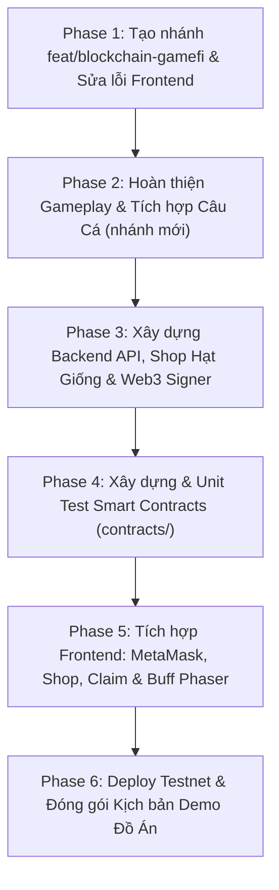

# KẾ HOẠCH PHÁT TRIỂN DỰ ÁN PIXEL2D GAMEFI (v3.0 - 6 PHASES)

> **Dự án**: Pixel2D GameFi - Nông Trại 2D Blockchain  
> **Nguyên tắc**: 
> 1. Tuyệt đối không can thiệp hay merge trực tiếp vào `main` và `origin/Fishing`. Mọi mã nguồn nằm trên nhánh `feat/blockchain-gamefi`.
> 2. Kiến trúc 3 tầng hoàn chỉnh: Frontend (React 19 + Phaser 4) + Backend (Express/SQLite) + Smart Contracts (Solidity Hardhat).

---

## TỔNG QUAN 6 GIAI ĐOẠN

---

## BẢNG KẾ HOẠCH CHI TIẾT THEO 6 GIAI ĐOẠN

### GIAI ĐOẠN 1: Tạo Nhánh Git Mới & Sửa Lỗi Nền Tảng Frontend
*Mục tiêu: Đảm bảo toàn bộ frontend build sạch sẽ, không lỗi TypeScript, routing chuẩn trên nhánh cô lập.*

| Task ID | Nhiệm vụ chi tiết | Ưu tiên | Độ khó | Thời gian | Đầu ra (Deliverables) | Tiêu chí nghiệm thu (Acceptance Criteria) |
| :--- | :--- | :---: | :---: | :---: | :--- | :--- |
| **TSK-1.0** | Tạo & checkout sang nhánh Git mới | P0 | Thấp | 5 phút | Nhánh `feat/blockchain-gamefi` từ `main` | `git branch` hiển thị `feat/blockchain-gamefi`. Nhánh `main` giữ nguyên 100%. |
| **TSK-1.1** | Sửa 3 lỗi TypeScript `TS6133` | P0 | Thấp | 15 phút | Xóa biến/kiểu thừa trong `FarmPlot.ts`, `FarmScene.ts`, `GamePage.tsx` | Chạy lệnh `pnpm run build` kết thúc thành công (exit code 0). |
| **TSK-1.2** | Chuẩn hóa Routing React Router | P0 | Thấp | 10 phút | Thêm route `/game` vào `App.tsx` | Click menu "Game" trên Navbar không bị redirect lặp. |
| **TSK-1.3** | Kích hoạt D-pad ảo cho Mobile | P1 | Thấp | 15 phút | Render cụm D-pad trong `GamePage.tsx` theo CSS `.game-controls` có sẵn | D-pad hiển thị trên mobile và điều khiển nhân vật qua event `farm-control`. |
| **TSK-1.4** | Dọn dẹp mã nguồn thừa | P2 | Thấp | 10 phút | Đánh dấu hoặc loại bỏ `PlotTile.ts` và `Farmer.ts` không dùng | Codebase sạch sẽ, không còn cảnh báo từ linter. |

---

### GIAI ĐOẠN 2: Hoàn Thiện Gameplay & Tích Hợp Câu Cá Trên Nhánh Mới
*Mục tiêu: Vòng lặp nông trại hoàn chỉnh (trừ hạt khi gieo, lưu nông sản vào kho) và tích hợp minigame câu cá từ `origin/Fishing`.*

| Task ID | Nhiệm vụ chi tiết | Ưu tiên | Độ khó | Thời gian | Đầu ra (Deliverables) | Tiêu chí nghiệm thu (Acceptance Criteria) |
| :--- | :--- | :---: | :---: | :---: | :--- | :--- |
| **TSK-2.1** | Tích hợp tính năng câu cá từ `origin/Fishing` | P0 | Trung bình | 1.5 giờ | Cherry-pick / tích hợp module `fishing/` vào nhánh `feat/blockchain-gamefi` | Đi đến hồ nước hiện prompt câu cá; minigame câu cá và nhận cá vào kho hoạt động trơn tru. |
| **TSK-2.2** | Sao chép tài nguyên công cụ Gold & Mobs Bloomseed | P1 | Thấp | 20 phút | Copy spritesheet từ `src/assets/Bloomseed` sang `public/assets/` | Phaser tải được hình ảnh công cụ cấp Gold (`Sickle`, `Watering Can`, `Hoe`) và cá quý. |
| **TSK-2.3** | Hoàn thiện Logic Trừ Hạt & Kho Nông Sản | P0 | Thấp | 45 phút | Sửa `FarmPlot.plant()` trừ số lượng hạt; `FarmPlot.harvest()` cộng vật phẩm nông sản vào kho | Không còn vô hạn hạt; gặt lúa nhận nông sản vào Inventory. |
| **TSK-2.4** | Xây dựng Modal Xem Nhiệm Vụ | P1 | Thấp | 45 phút | Modal hiển thị danh sách 4 nhiệm vụ trong `mock-data/quests.ts` kèm nút nhận thưởng | Click thẻ ghim mở popup danh sách quest; nhận thưởng cộng coin thành công. |

---

### GIAI ĐOẠN 3: Xây Dựng Backend API, Shop Hạt Giống & Web3 Signer (`backend/`)
*Mục tiêu: Máy chủ backend quản lý dữ liệu người chơi, shop bán hạt giống bằng Coin và dịch vụ ký duyệt claim token an toàn.*

| Task ID | Nhiệm vụ chi tiết | Ưu tiên | Độ khó | Thời gian | Đầu ra (Deliverables) | Tiêu chí nghiệm thu (Acceptance Criteria) |
| :--- | :--- | :---: | :---: | :---: | :--- | :--- |
| **TSK-3.1** | Khởi tạo dự án `backend/` (Node.js/Express + SQLite) | P0 | Thấp | 45 phút | Cấu trúc thư mục `backend/` với TypeScript, Express, SQLite schema | Khởi động server tại cổng 3001, kết nối DB thành công. |
| **TSK-3.2** | API Xác thực ví (SIWE) & Đồng bộ Trạng thái Game | P0 | Trung bình | 1.5 giờ | `POST /api/auth/login-wallet`, `GET/POST /api/game/state` | Đăng nhập bằng chữ ký ví, lưu và lấy lại Coin/Inventory/Quest theo ví. |
| **TSK-3.3** | API Shop Mua Hạt Giống bằng In-Game Coin | P0 | Trung bình | 1 giờ | `GET /api/shop/items`, `POST /api/shop/buy` | Trừ Coin trong DB và cộng hạt giống vào Inventory người chơi. |
| **TSK-3.4** | Dịch vụ Web3 Signer ký duyệt rút Coin sang `$PIXEL` | P0 | Trung bình | 1.5 giờ | `POST /api/web3/create-claim-signature` | Kiểm tra coin hợp lệ, trừ coin và ký chữ ký ECDSA (EIP-712) trả về client. |
| **TSK-3.5** | API Lịch sử Giao dịch On-chain / Off-chain | P1 | Thấp | 45 phút | `GET /api/transactions` | Lưu và trả về log mua hạt giống và các lần rút token on-chain. |

---

### GIAI ĐOẠN 4: Xây Dựng & Kiểm Thử Smart Contracts (`contracts/`)
*Mục tiêu: Cụm Smart Contract độc lập chuẩn bảo mật OpenZeppelin, hỗ trợ 1-Click Mint và Test suite 100% pass.*

| Task ID | Nhiệm vụ chi tiết | Ưu tiên | Độ khó | Thời gian | Đầu ra (Deliverables) | Tiêu chí nghiệm thu (Acceptance Criteria) |
| :--- | :--- | :---: | :---: | :---: | :--- | :--- |
| **TSK-4.1** | Khởi tạo môi trường Hardhat độc lập ở root | P0 | Thấp | 30 phút | Thư mục `contracts/` độc lập, cấu hình compiler Solidity 0.8.20 | Lệnh `npx hardhat compile` chạy sạch sẽ. |
| **TSK-4.2** | Viết Token `$PIXEL` (`PixelFarmToken.sol`) | P0 | Trung bình | 1.5 giờ | Hợp đồng ERC-20 kiểm tra chữ ký Backend Signer, Cap (100), Cooldown (5p), Daily Faucet | Xác thực ECDSA hoạt động chuẩn xác, chống Replay Attack qua `usedNonces`. |
| **TSK-4.3** | Viết NFT Nông Cụ (`FarmItemNFT.sol`) | P0 | Trung bình | 1.5 giờ | Hợp đồng ERC-721 nhận `BURNER_ROLE` từ Token, thực hiện 1-Click Mint và hàm `getOwnedItems` | Mua NFT không cần lệnh `approve` riêng; đọc trạng thái sở hữu 4 loại NFT mượt mà. |
| **TSK-4.4** | Script Deploy & Tự động xuất ABI/Address sang Frontend | P0 | Thấp | 45 phút | `scripts/deploy.ts` tự động sinh ABI JSON sang `front_end/src/web3/abis/` | Frontend có sẵn file ABI và địa chỉ để import mà không bị lỗi typecheck. |
| **TSK-4.5** | Viết bộ Unit Test tự động (Hardhat Test Suite) | P0 | Trung bình | 1.5 giờ | `test/PixelFarm.test.ts` kiểm thử toàn bộ luồng Claim, Faucet, 1-Click Mint | Đạt 100% test cases pass trên local Hardhat Network. |

---

### GIAI ĐOẠN 5: Tích Hợp Frontend (Ví MetaMask, Shop Hạt Giống, Claim & Buff Phaser)
*Mục tiêu: Đưa toàn bộ giao diện Web3, Shop in-game và cầu nối Buff NFT vào trải nghiệm người chơi.*

| Task ID | Nhiệm vụ chi tiết | Ưu tiên | Độ khó | Thời gian | Đầu ra (Deliverables) | Tiêu chí nghiệm thu (Acceptance Criteria) |
| :--- | :--- | :---: | :---: | :---: | :--- | :--- |
| **TSK-5.1** | Viết Custom Hook `useWeb3.ts` (Ethers v6) | P0 | Trung bình | 1.5 giờ | Hook quản lý kết nối ví MetaMask, chuyển mạng testnet, số dư ETH & `$PIXEL` | Kết nối ví mượt mà, tự động cập nhật khi đổi tài khoản trên MetaMask. Tương thích React 19. |
| **TSK-5.2** | Nút Connect Wallet & Hiển thị số dư On-chain trên Navbar | P0 | Thấp | 45 phút | `AppNavbar.tsx` hiển thị trạng thái ví rút gọn (`0x12..ab`), mạng testnet, số dư token | Giao diện rõ ràng, chuẩn phong cách pixel retro. |
| **TSK-5.3** | Giao diện Cửa hàng Mua Hạt Giống bằng Coin (Seed Shop Modal) | P0 | Trung bình | 1.5 giờ | Popup mua hạt giống kết nối API `POST /api/shop/buy` | Dùng Coin kiếm được để mua hạt giống, hạt lập tức xuất hiện trong kho đồ. |
| **TSK-5.4** | Modal "Sync In-Game Coins to $PIXEL" có cơ chế Khóa Coin | P0 | Trung bình | 1.5 giờ | Popup gọi API Signer -> MetaMask ký claim -> Khóa & Khấu trừ Coin thật | Không bị mất coin nếu cancel; không bị double-spending. |
| **TSK-5.5** | Giao diện Web3 NFT Shop (1-Click Mint) | P0 | Trung bình | 1.5 giờ | Popup duyệt 4 loại NFT (Liềm vàng, Bình tưới vàng, Cuốc vàng, Cá vàng) | Nhấn mua -> 1 chữ ký ví -> Token `$PIXEL` bị trừ và NFT xuất hiện trong ví. |
| **TSK-5.6** | Cầu nối Buff NFT (React -> Phaser) & Lịch sử Giao dịch | P0 | Trung bình | 1 giờ | Bắn event `web3-buff-updated` xuống Phaser; Modal xem log giao dịch | Có NFT Bình tưới vàng -> Cây lớn nhanh hơn 20% và icon Toolbar đổi sang Gold. |

---

### GIAI ĐOẠN 6: Triển Khai Testnet Công Khai & Đóng Gói Demo Đồ Án
*Mục tiêu: Đồ án hoàn chỉnh 100%, sẵn sàng chạy demo và bảo vệ trước hội đồng.*

| Task ID | Nhiệm vụ chi tiết | Ưu tiên | Độ khó | Thời gian | Đầu ra (Deliverables) | Tiêu chí nghiệm thu (Acceptance Criteria) |
| :--- | :--- | :---: | :---: | :---: | :--- | :--- |
| **TSK-6.1** | Deploy Smart Contracts lên Public Testnet (Sepolia/Polygon Amoy) | P0 | Trung bình | 1 giờ | Hợp đồng deployed và verified trên Block Explorer | Có link explorer công khai tra cứu được giao dịch on-chain. |
| **TSK-6.2** | Kiểm thử End-to-End toàn bộ luồng người chơi | P0 | Trung bình | 1.5 giờ | Luồng: Đăng nhập ví -> Trồng trọt/Câu cá -> Mua hạt giống -> Rút Token -> 1-Click Mint NFT -> Nhận Buff | Chạy trơn tru từ A đến Z, không lỗi console. |
| **TSK-6.3** | Tài liệu Hướng dẫn Chạy & Kịch bản Thuyết trình Đồ án | P1 | Thấp | 1 giờ | Cập nhật `README.md` toàn diện và slide/kịch bản demo mẫu | Người khác clone repo có thể khởi động cả 3 tầng (Frontend, Backend, Contracts) dễ dàng. |
